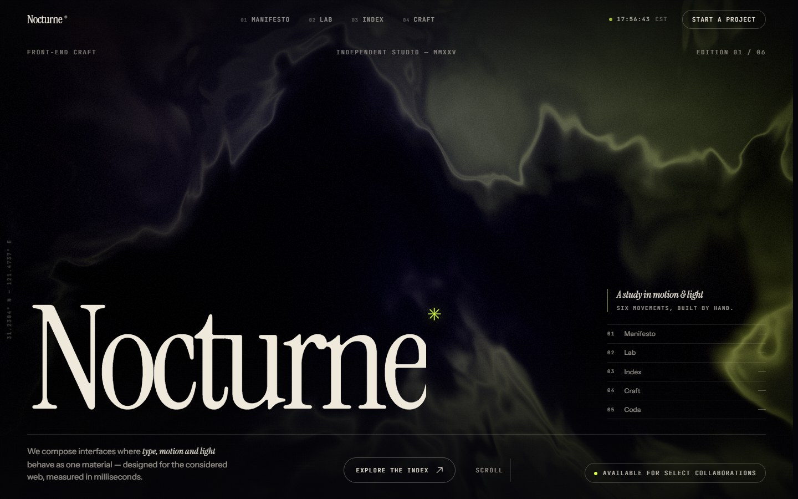
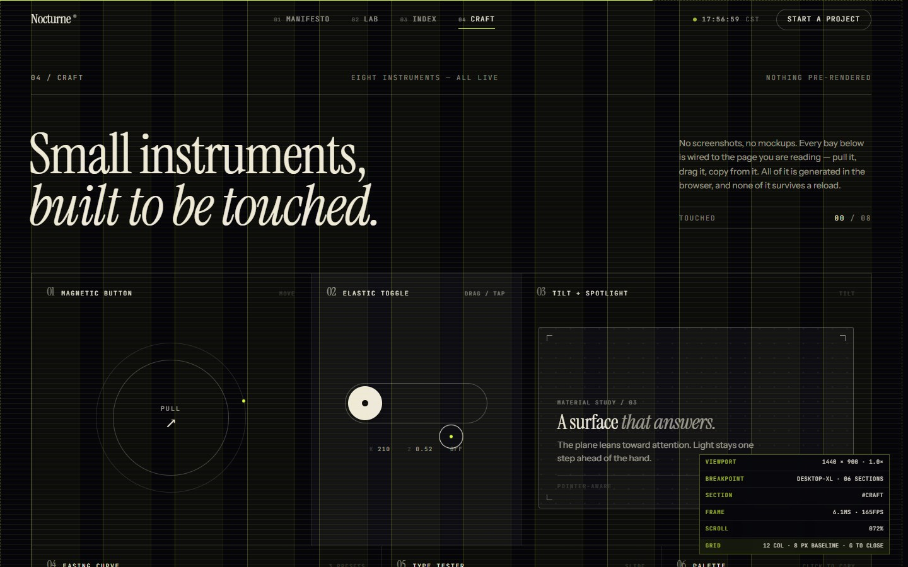
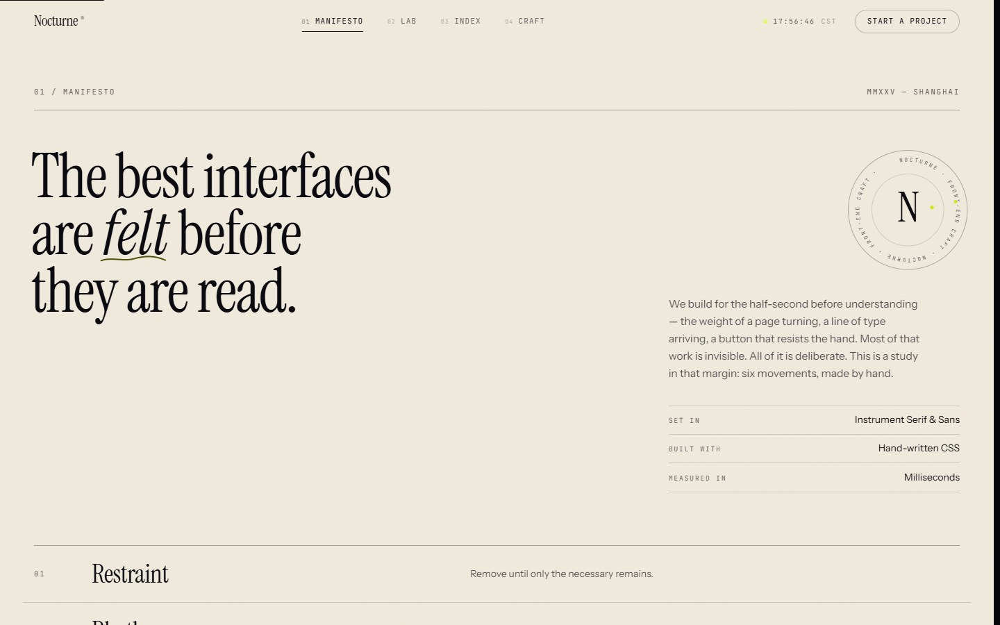
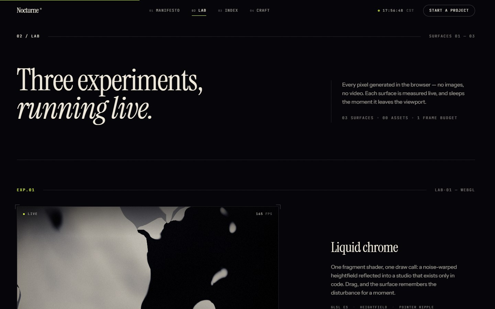
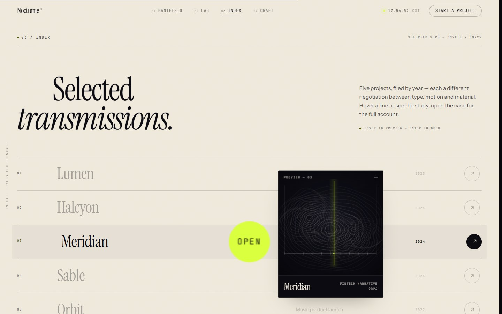
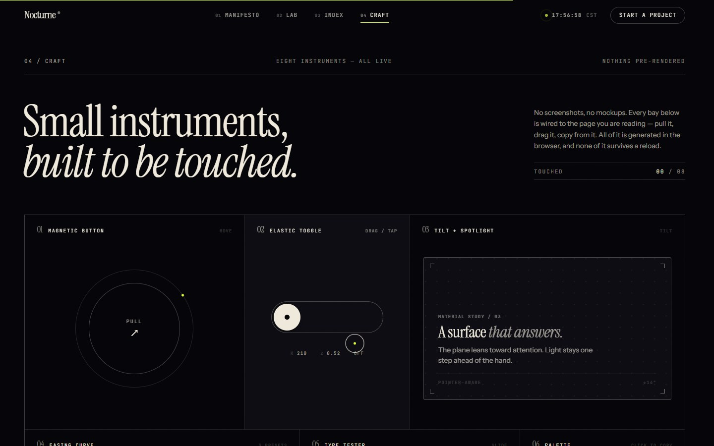
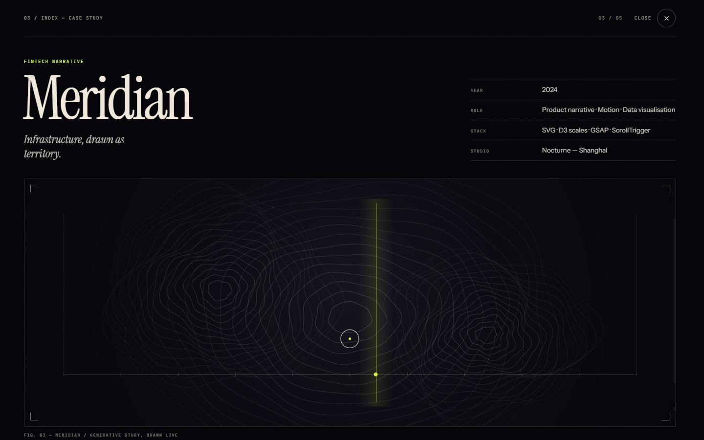
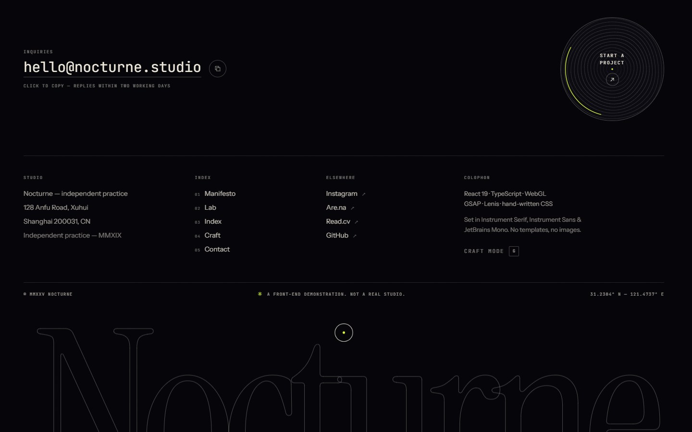
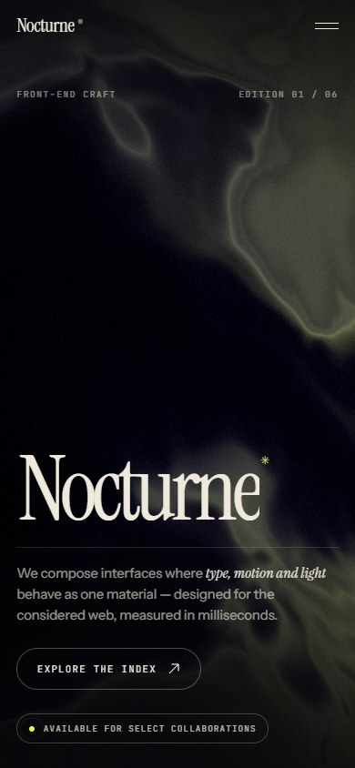

# Nocturne

**A front-end craft demonstration in six movements.**

Nocturne is a single-page experience built to show what the front end can feel like when type, motion, light and engineering are treated as one material. It is not a template, not a page builder, and not a gallery of screenshots: every visual on screen is generated in the browser — WebGL, canvas, SVG and CSS. There is not a single image file in the interface.

```
Void black. Warm bone. One acid accent.
Six movements. Zero images. Zero UI libraries.
```



---

## Quick start

```bash
pnpm install
pnpm dev          # http://localhost:5178
```

```bash
pnpm build        # typecheck + production build into dist/
pnpm preview      # serve the production build
pnpm typecheck    # TypeScript only
```

Requires Node 20+ and a browser with WebGL. The site degrades to a CSS atmosphere if WebGL is unavailable, and to a fully readable, motion-free page under `prefers-reduced-motion: reduce`.

---

## Deployment flavours

Two builds live side by side — the dynamic development version is untouched by packaging:

| Version | Command | Output | Notes |
| --- | --- | --- | --- |
| Dynamic / dev | `pnpm dev` | dev server on `:5178` | Live HMR version; keep it running |
| Production (root) | `pnpm build` | `dist/` | Absolute asset paths — deploy at a domain root |
| **Static (portable)** | `pnpm build:static` | `dist-static/` | **Relative paths** — works at a domain root *or* any sub-directory |

**Ready-to-upload release:** [`releases/nocturne-static-v1.0.0.zip`](releases/nocturne-static-v1.0.0.zip) (405 kB, SHA-256 in [`releases/SHA256SUMS.txt`](releases/SHA256SUMS.txt)).
Unzip, upload the contained folder's files to any static host, done — no build step, no server, no SPA rewrite rules, no environment variables, no third-party requests.
Full instructions (headers, MIME types, sub-path deployment): [`releases/DEPLOY.md`](releases/DEPLOY.md).

```bash
pnpm build:static     # → dist-static/
pnpm preview:static   # serve dist-static at http://localhost:5182
```

---

## The six movements

| # | Section | Idea |
|---|---------|------|
| 01 | **Overture** | A domain-warped silk-field hero: WebGL light that bends toward the cursor. Kinetic serif type, an index of the movements. |
| 02 | **Manifesto** | A printed page turned open — masked statement lines, a hand-drawn underline, a seal that keeps time, then a full-bleed marquee. |
| 03 | **Lab** | Three live experiments: liquid chrome (WebGL), a curl-noise particle field (canvas), and particle type that morphs between words (canvas). |
| 04 | **Index** | Five projects as an editorial index. Hover for a generative preview that follows the cursor; open a full case study in an accessible overlay. |
| 05 | **Craft** | A bento of eight working instruments: magnetic button, spring toggle, tilt/spotlight card, easing-curve playground, variable-font tester, copyable palette, frame meter, scroll seismograph. |
| 06 | **Coda** | A closing statement, a magnetic CTA, a colophon that tells the truth: this is a demonstration. |

Plus a hidden extra: press **G** (or use the footer link) to reveal **Craft mode** — a 12-column grid, an 8px baseline, section bounds, and a live HUD with viewport, breakpoint, frame time and scroll telemetry.



---

## A look inside

| Manifesto | Lab |
|---|---|
|  |  |

| Index | Craft |
|---|---|
|  |  |

| Case study | Coda |
|---|---|
|  |  |

Mobile layout is a first-class citizen, not a breakpoint afterthought:



More frames in [`docs/`](docs/).

---

## Stack

- **React 19** + **TypeScript** — component architecture, no UI framework
- **Vite 8** — dev server and build
- **GSAP 3 + ScrollTrigger** — scroll choreography, timeline craft
- **Lenis** — inertial smooth scroll, wired into GSAP's ticker
- **Raw WebGL** — a small `GLStage` abstraction (DPR-aware resize, visibility pausing, uniform plumbing, context-loss handling) with hand-written GLSL. No three.js in the shipped site.
- **Self-hosted webfonts** — Instrument Serif, Instrument Sans, JetBrains Mono (OFL). Zero third-party requests at runtime.

Production bundle: **17.2 kB CSS** and **156 kB JS** gzipped (React + GSAP + Lenis + the entire site). ~810 DOM nodes on the full page; two WebGL contexts.

---

## Architecture

```
src/
├─ components/           # one component per movement, plus shell chrome
│  ├─ Hero.tsx           # signature WebGL hero
│  ├─ Preloader.tsx      # curtain, counts real font readiness
│  ├─ Nav.tsx            # theme-aware header, directional auto-hide, full-screen menu
│  ├─ Cursor.tsx         # two-part custom cursor with intent states
│  ├─ CraftMode.tsx      # the G-key design-engineering overlay
│  ├─ Manifesto.tsx … Coda.tsx
│  ├─ lab/ work/ craft/  # section-scoped experiments & sub-components
├─ lib/
│  ├─ gl.ts              # GLStage — WebGL surface manager
│  ├─ glsl.ts            # shared GLSL chunks (noise, fbm, tonemap, dither)
│  ├─ scroll.ts          # Lenis + ScrollTrigger integration, easing tokens
│  ├─ split.ts           # dependency-free split text (words / chars / lines)
│  ├─ reveal.ts          # declarative scroll choreography + magnetic hover
│  ├─ pointer.ts         # one rAF for the whole app
│  └─ utils.ts
├─ shaders/              # hand-written fragment shaders
└─ styles/               # tokens · base · per-component CSS (BEM-ish)
```

Most scroll animation is **declarative** — a section opts in with attributes:

```html
<h2 data-split="lines">The best interfaces…</h2>
<div data-reveal data-reveal-delay="0.2">…</div>
<div data-parallax="0.12">…</div>
<ul data-reveal-group="0.075">…</ul>
```

`useReveals(ref)` wires them once fonts are ready. Split text restores the original markup after the reveal, so layout is never locked to the animation.

---

## Accessibility & performance

- Semantic landmarks, one `h1`, labelled sections, `aria-hidden` on decorative canvases.
- Skip link (focus moves to `main`), visible focus rings, keyboard-trapped dialogs with focus restore, ESC to close, inert background while the case study is open.
- Full `prefers-reduced-motion` path: no curtain, no parallax, static shader frames, every revealed element starts visible.
- Every canvas pauses offscreen and on tab hide; device pixel ratios are clamped; one pointer rAF loop serves the whole page; no external assets.
- Text contrast audited against WCAG AA for every small-label style; the custom cursor is disabled for coarse pointers and reduced-motion users.
- Directional header auto-hide keeps the fixed nav from colliding with content; it returns on scroll-up and stays pinned during anchor jumps.

Design rationale, motion system and WebGL notes: [`DESIGN.md`](DESIGN.md). The final audit, measured numbers and triaged non-issues: [`reports/qa-final.md`](reports/qa-final.md).

---

## Credits

Design and engineering: built as a front-end demonstration.
Typefaces: [Instrument Serif](https://fonts.google.com/specimen/Instrument+Serif), [Instrument Sans](https://fonts.google.com/specimen/Instrument+Sans), [JetBrains Mono](https://www.jetbrains.com/lp/mono/) — SIL Open Font License, self-hosted.
Fictional studio, fictional projects. Not a real agency.
